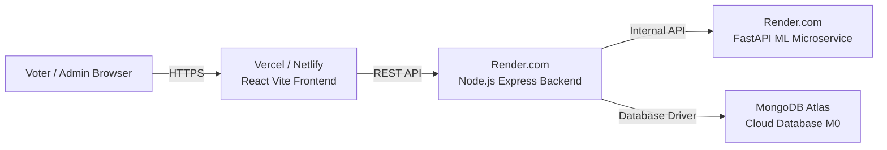

# Free Cloud Deployment Guide

This guide walks you through deploying the **AI-Based Secure Online Voting System** to the cloud so anyone in the world can access it via a public URL (e.g. `https://my-voting-app.vercel.app`) from their phone, tablet, or laptop 24/7 without needing your personal laptop turned on.

---

## Architecture Overview



| Component | Cloud Provider | Free Tier Details |
| :--- | :--- | :--- |
| **Database** | [MongoDB Atlas](https://www.mongodb.com/cloud/atlas) | 512MB Shared M0 (Free Forever) |
| **ML Microservice** | [Render.com](https://render.com) | Free Web Service (Python 3.11) |
| **Backend API** | [Render.com](https://render.com) | Free Web Service (Node.js) |
| **Frontend UI** | [Vercel](https://vercel.com) | Free Hobby Plan (Global CDN) |

---

## Step 1: Push Code to GitHub

1. Open [GitHub.com](https://github.com) and click **New Repository**.
2. Name it `ai-secure-voting-system` and keep it **Public** (or Private).
3. Do NOT check "Add a README" or ".gitignore". Click **Create repository**.
4. In your project terminal or Command Prompt, run:
   ```bash
   git remote add origin https://github.com/<YOUR_GITHUB_USERNAME>/ai-secure-voting-system.git
   git branch -M main
   git push -u origin main
   ```

---

## Step 2: Set Up MongoDB Atlas (Cloud Database)

1. Sign up or log in at [mongodb.com/cloud/atlas](https://www.mongodb.com/cloud/atlas).
2. Click **Create a Deployment** -> Select **M0 (Free)** -> Choose your closest AWS region -> Click **Create**.
3. **Database Access (User):**
   - Username: `admin`
   - Password: Choose a secure password (e.g., `VoteSystem@2026`) -> Click **Create Database User**.
4. **Network Access (IP Whitelist):**
   - Click **Network Access** in the left sidebar.
   - Click **Add IP Address** -> Choose **Allow Access from Anywhere** (`0.0.0.0/0`) -> Click **Confirm**.
5. **Get Connection String:**
   - Go to **Database** -> Click **Connect** -> Select **Drivers** (Node.js).
   - Copy your connection string:
     ```
     mongodb+srv://admin:<password>@cluster0.xxxxx.mongodb.net/ai_voting_system?retryWrites=true&w=majority
     ```
   *(Replace `<password>` with your actual database password).*

---

## Step 3: Deploy FastAPI ML Microservice on Render

1. Log in to [Render.com](https://render.com) with GitHub.
2. Click **New +** -> **Web Service**.
3. Connect your `ai-secure-voting-system` GitHub repository.
4. Fill in the settings:
   - **Name:** `ai-voting-ml-service`
   - **Root Directory:** `ml-service`
   - **Runtime:** `Python 3`
   - **Build Command:** `pip install -r requirements.txt`
   - **Start Command:** `python -m uvicorn main:app --host 0.0.0.0 --port $PORT`
   - **Instance Type:** `Free`
5. **Environment Variables:**
   - Click **Add Environment Variable**:
     - `PYTHON_VERSION`: `3.11.9`
     - `FACE_MATCH_DISTANCE_THRESHOLD`: `0.76`
     - `ENVIRONMENT`: `production`
6. Click **Deploy Web Service**.
7. Once deployed, copy your ML Service URL:
   `https://ai-voting-ml-service.onrender.com`

---

## Step 4: Deploy Express Backend API on Render

1. On [Render.com](https://render.com), click **New +** -> **Web Service**.
2. Connect the same GitHub repository.
3. Fill in the settings:
   - **Name:** `ai-voting-backend-api`
   - **Root Directory:** `server`
   - **Runtime:** `Node`
   - **Build Command:** `npm install`
   - **Start Command:** `node server.js`
   - **Instance Type:** `Free`
4. **Environment Variables:**
   Click **Add Environment Variable** and enter:
   | Key | Value |
   | :--- | :--- |
   | `NODE_ENV` | `production` |
   | `MONGODB_URI` | *(Your MongoDB Atlas URL from Step 2)* |
   | `JWT_ACCESS_SECRET` | `prod_super_secret_access_key_min_32_characters_12345` |
   | `JWT_REFRESH_SECRET` | `prod_super_secret_refresh_key_min_32_characters_67890` |
   | `ML_SERVICE_URL` | `https://ai-voting-ml-service.onrender.com` *(from Step 3)* |
   | `SMTP_HOST` | `smtp.gmail.com` |
   | `SMTP_PORT` | `465` |
   | `SMTP_USER` | `pagadalathanujaa@gmail.com` |
   | `SMTP_PASS` | `nyvt kfuo ebla dbhd` |
   | `EMAIL_FROM` | `"AI Secure Voting" <pagadalathanujaa@gmail.com>` |
   | `CLIENT_URL` | `https://your-app.vercel.app` *(update after Step 5)* |
5. Click **Deploy Web Service**.
6. Once deployed, copy your Backend URL:
   `https://ai-voting-backend-api.onrender.com`

---

## Step 5: Deploy React Frontend on Vercel

1. Log in to [Vercel.com](https://vercel.com) with GitHub.
2. Click **Add New...** -> **Project**.
3. Import your `ai-secure-voting-system` repository.
4. Configure Project:
   - **Framework Preset:** `Vite`
   - **Root Directory:** Click **Edit** and select `client`
5. **Environment Variables:**
   - Key: `VITE_API_BASE_URL`
   - Value: `https://ai-voting-backend-api.onrender.com/api/v1` *(your backend URL + `/api/v1`)*
6. Click **Deploy**.
7. In ~60 seconds, your site is live! You will get your public URL:
   👉 **`https://ai-secure-voting-system.vercel.app`**

---

## Step 6: Final 2-Minute Sync

1. Go back to your Backend on Render -> **Environment**.
2. Update `CLIENT_URL` with your actual Vercel domain (e.g. `https://ai-secure-voting-system.vercel.app`).
3. (Optional) Run the seed script to populate initial elections:
   - In Render Backend -> **Shell** tab:
     ```bash
     node ../scripts/seed_database.js
     ```

🎉 **Congratulations!** Your AI Secure Voting System is now live on the internet!

