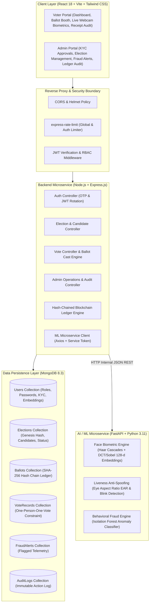
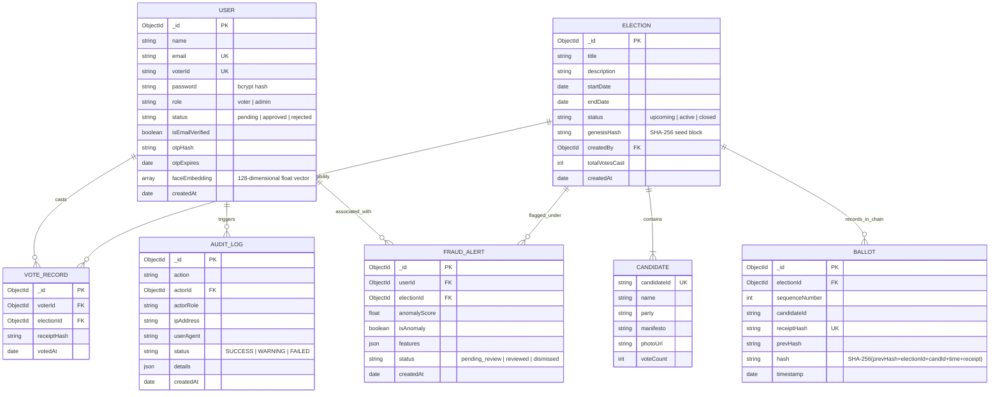
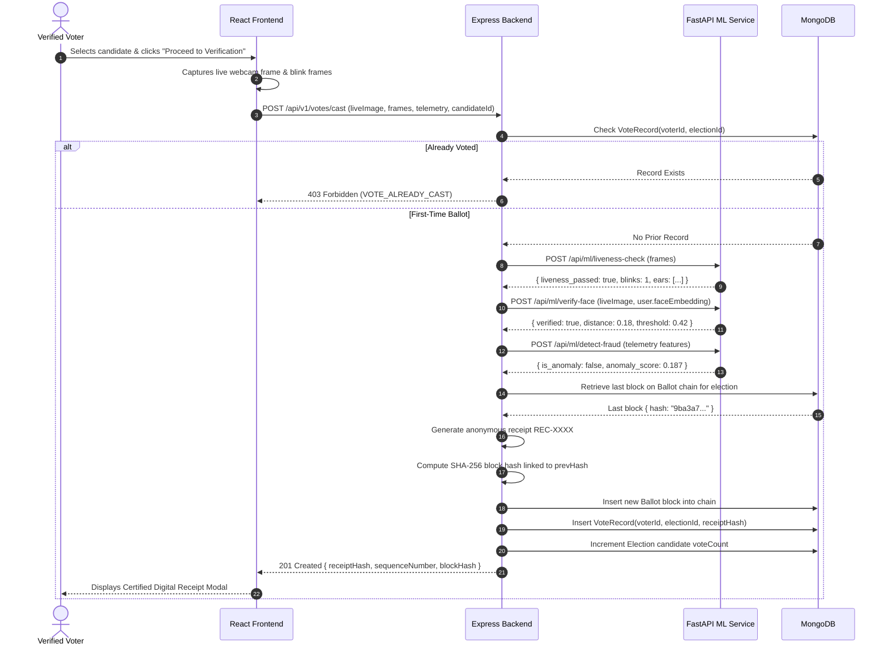
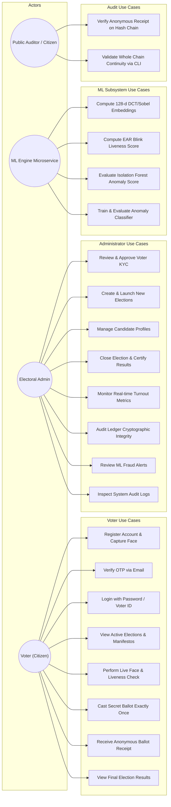

# System Diagrams: AI-Based Secure Online Voting Platform

This document presents the complete architectural, structural, and behavioral modeling diagrams for the voting platform using Mermaid syntax.

---

## 1. High-Level System Architecture Diagram

---

## 2. Entity-Relationship Diagram (ERD)

> **Security Note on Anonymity**: Notice that `BALLOT` contains `candidateId`, `prevHash`, `hash`, and `receiptHash`, but **never** stores `voterId`. `VOTE_RECORD` stores `voterId`, `electionId`, and `receiptHash`, but **never** stores `candidateId`. Thus, the ballot is strictly decoupled from voter identity, guaranteeing secret balloting while still maintaining a verifiable receipt!

---

## 3. Data Flow & Sequence Diagram: Secure Ballot Casting

---

## 4. Use Case Diagram

